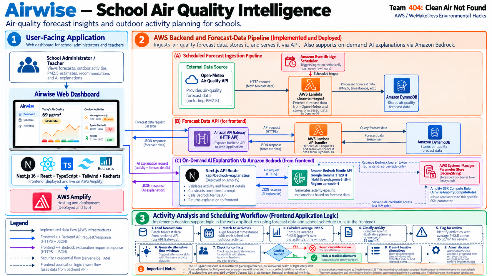
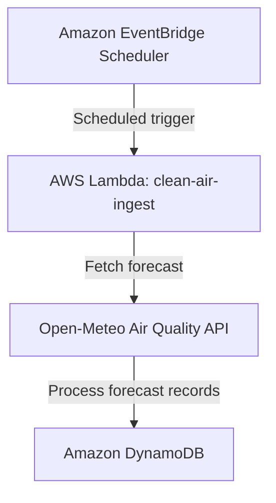
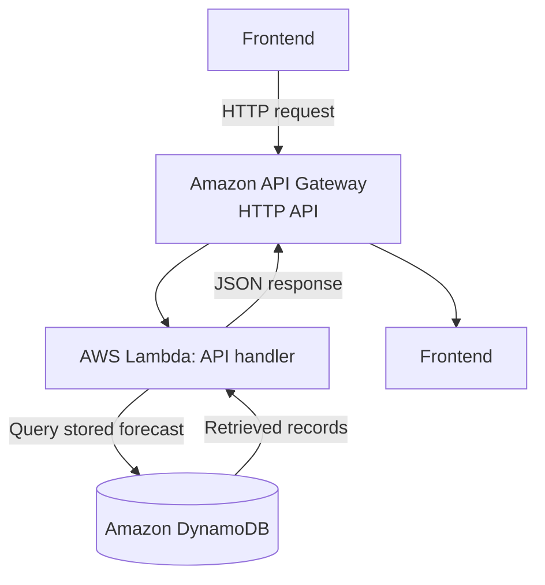
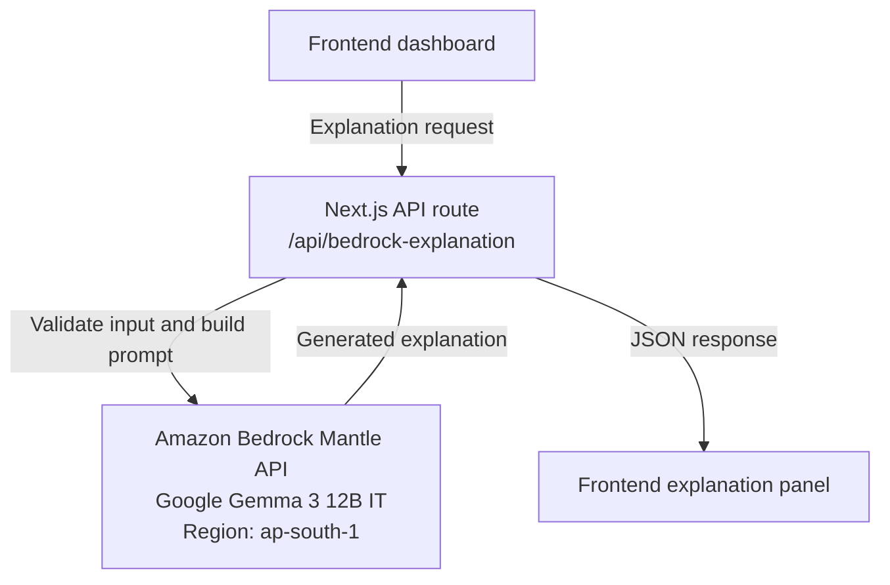
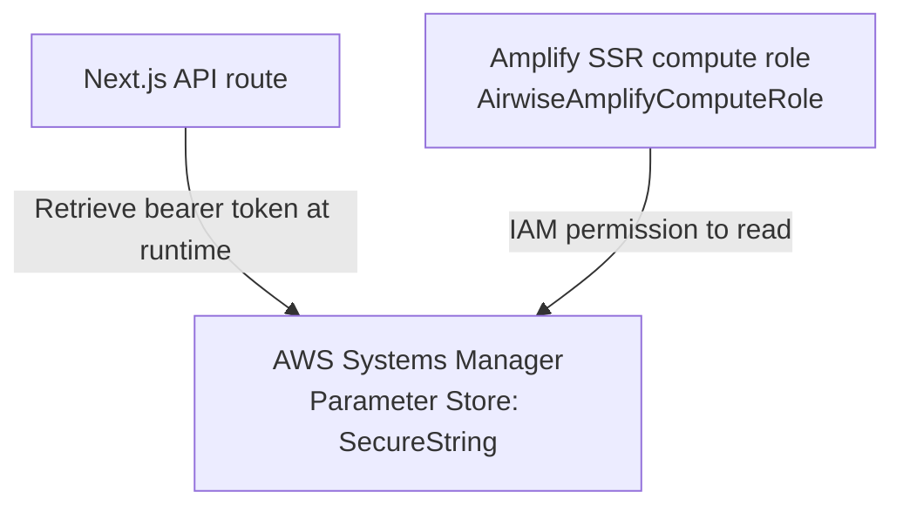
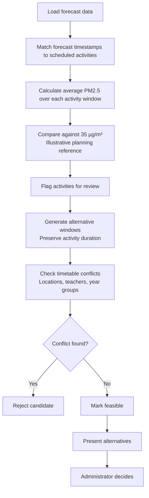

# Airwise — School Air Quality Intelligence

**Team 404: Clean Air Not Found** · AWS / WeMakeDevs Environmental Hacks 2026

**[Launch Airwise →](https://main.divfs8o5h0w7c.amplifyapp.com)**

Airwise is a school air-quality decision-support dashboard that helps administrators and teachers review outdoor activities using air-quality forecasts, activity-aware scheduling, and AI-generated explanations.

## The Problem

When air pollution is forecast to rise, schools need to identify outdoor activities that may warrant review and find alternative time slots without creating timetable conflicts.

## What Airwise Does

- **Air-quality forecasts:** Visualizes hourly PM2.5 forecasts to help staff understand changing conditions.
- **Activity-level analysis:** Estimates average forecast PM2.5 over each activity's scheduled time window.
- **Smart rescheduling:** Suggests alternative time windows while preserving activity duration and checking timetable conflicts involving locations, teachers, and year groups.
- **AI explanations:** Uses Google Gemma 3 12B IT through Amazon Bedrock Mantle to explain supplied activity and forecast details.
- **Human-led decisions:** Helps staff evaluate options without autonomously cancelling activities or declaring conditions safe.

The dashboard uses demonstration school timetable data. The configured forecast location is Delhi, India, rather than a specific school's coordinates.

## Architecture

Airwise separates the deployed web application, AWS forecast-ingestion pipeline, forecast-data API, frontend scheduling logic, and on-demand AI explanation workflow.

- **Web application:** Next.js 16, React, TypeScript, Tailwind CSS, and Recharts, deployed on AWS Amplify Hosting.
- **Forecast ingestion:** Amazon EventBridge Scheduler triggers AWS Lambda (`clean-air-ingest`), which retrieves forecast data from Open-Meteo and stores processed records in DynamoDB.
- **Forecast API:** Amazon API Gateway (HTTP API) routes requests to a Lambda API handler that retrieves stored forecast data.
- **AI explanations:** The Next.js API route `/api/bedrock-explanation` calls Amazon Bedrock Mantle using Google Gemma 3 12B IT (`google.gemma-3-12b-it`) in `ap-south-1`.
- **Credential security:** AWS Systems Manager Parameter Store stores the Bedrock bearer token as a `SecureString`. The server-side API route retrieves it using permissions granted to the Amplify SSR compute role.

Activity analysis and timetable-conflict checking run in the frontend/application layer, not in a separate scheduling microservice.

## System Workflows

### 1. Forecast Ingestion

### 2. Forecast API Request and Response

The scheduled ingestion path and forecast API are distinct flows. The AWS backend should not be assumed to power every forecast calculation in the deployed dashboard unless that integration has been verified.

### 3. AI Explanation Workflow

#### Server-Side Credential Retrieval

The Bedrock request is initiated on demand by the user. It does not pass through the forecast API Gateway endpoint or the EventBridge ingestion pipeline.

The bearer token must remain server-side. It must never be exposed through frontend environment variables, bundled into browser code, or returned to the frontend.

### 4. Activity Analysis and Rescheduling

The scheduling engine runs in frontend/application logic.

Conflicting candidate windows are rejected; feasible candidates are presented to the administrator. Where implemented, the administrator can accept a proposed time or revert to the original schedule.

A feasible timetable slot is not necessarily a safe air-quality slot. The system assists school staff but does not make autonomous safety decisions.

## Technology Stack

| Component | Technology |
|---|---|
| Frontend | Next.js 16, React, TypeScript |
| Styling and charts | Tailwind CSS, Recharts |
| Hosting | AWS Amplify Hosting |
| Forecast provider | Open-Meteo Air Quality API |
| Forecast ingestion | Amazon EventBridge Scheduler, AWS Lambda |
| Forecast storage | Amazon DynamoDB |
| Forecast API | Amazon API Gateway (HTTP API), AWS Lambda |
| AI explanations | Amazon Bedrock Mantle, Google Gemma 3 12B IT |
| Credential storage | AWS Systems Manager Parameter Store |

## Data and Limitations

- **Pollutant:** PM2.5, measured in micrograms per cubic metre (`µg/m³`).
- **Forecast provider:** [Open-Meteo Air Quality API](https://open-meteo.com/en/docs/air-quality-api).
- **Configured forecast location:** Delhi, India.
- **Time zone:** `Asia/Kolkata`.
- **Planning reference:** `35 µg/m³` is an illustrative planning reference, not a universal health or legal safety threshold.
- **Forecast estimates:** Activity-window averages may differ from actual conditions at a school.
- **Demonstration data:** The school timetable uses demo activities rather than a live school's schedule.
- **AI limitations:** Generated explanations may be incomplete or inaccurate and should be reviewed by staff.
- **Data-source scope:** The described forecast pipeline uses Open-Meteo; it does not ingest CPCB station measurements.

Airwise does not independently certify that an activity is safe or replace official public-health guidance. School staff retain final decision-making responsibility.

## Team

**404: Clean Air Not Found**

Built for AWS / WeMakeDevs Environmental Hacks 2026.
